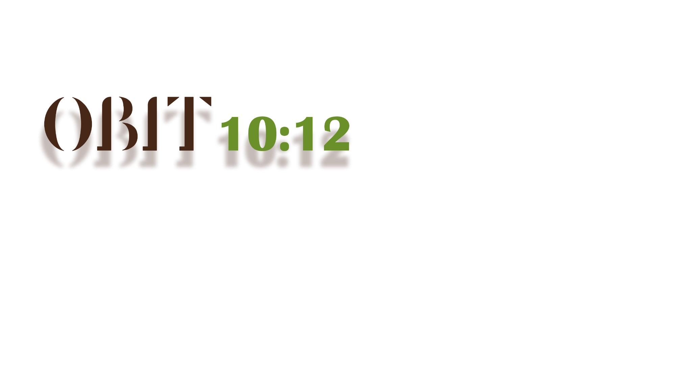

<div align="center">
  

  <p><strong>从 10:12 的清晨出发，陪钟浩度过一整天。</strong></p>
  <p>A small birthday journey made for JONGHO.</p>

  <p>
    <a href="https://okaleno.github.io/ORBIT-10-12/"><strong>▶ PLAY ONLINE</strong></a>
    &nbsp;·&nbsp;
    <a href="docs/PROJECT-NOTES.md">PROJECT NOTES</a>
  </p>

  <p>
    
    
    
  </p>
</div>

---

## About the game

**ORBIT 10:12** 是一个非商业生日应援网页小游戏。玩家会从卧室叫醒钟浩，为他选择今天的穿搭，再一起走过长街、餐厅与两段海滩时光，最后回到夜晚的卧室，收藏这一天留下的照片、贺卡和回忆。

无需下载或安装。使用现代浏览器打开在线地址，建议佩戴耳机并以横屏游玩。

## A day in ORBIT

| Time | Scene | What happens |
| :--: | --- | --- |
| **10:12** | Bedroom | 拉开窗帘、叫醒人物、探索房间 |
| **Morning** | Wardrobe | 选择服装并确认今日穿搭 |
| **11:30** | Street | 散步、发现街景互动、选择饮品 |
| **12:30** | Restaurant | 点餐、装饰蛋糕、写下生日贺卡 |
| **15:00** | Beach | 拍摄并保存属于这一周目的拍立得 |
| **17:30** | Sunset | 听歌、聊天，看海面慢慢变暗 |
| **23:40** | Bedroom | 带着白天收集的物品回家 |
| **Epilogue** | Memory | 回顾旅程并保存纪念卡 |

## Highlights

- 三语界面与对白：简体中文、한국어、English
- 场景间连续保存服装、饮品、蛋糕、贺卡与第一张海滩照片
- 鼠标、触控和横屏移动端操作
- 原生 HTML、CSS 与 JavaScript，无框架、无安装步骤
- 多段环境音、BGM、角色互动和手绘动画

## Controls

- **点击 / 轻触**：互动、推进对白、选择物品
- **滚轮 / 横向拖动**：在长街移动
- **拖动**：换装与海滩拍照操作
- **右上角按钮**：控制声音或返回上一场景

## Run locally

项目是纯静态网站。在仓库根目录启动本地服务器：

```bash
python -m http.server 8080
```

然后访问 `http://localhost:8080/`。仓库使用 Git LFS 保存菜单背景，克隆后请先运行 `git lfs pull`。

## Project map

```text
ORBIT-10-12/
├─ assets/        # 主菜单、卧室、换装与共用音频
├─ street/        # 长街
├─ restaurant/    # 餐厅
├─ beach/         # 白天海滩与拍立得
├─ finale/        # 日落海滩、夜晚卧室与终幕
├─ epilogue/      # 尾声与纪念卡
└─ index.html     # 游戏入口
```

更完整的场景流程、状态字段和维护说明见 [Project Notes](docs/PROJECT-NOTES.md)。

## Credits & notice

这是为 ATEEZ JONGHO 制作的非商业粉丝项目。项目中的人物、名称、音乐及相关素材权利归各自权利人所有；本项目仅用于生日应援与非商业展示。

<div align="center">
  <strong>ORBIT 10:12</strong><br />
  All for ATEEZ JONGHO · See you again next year.
</div>
